# Unified AI Workspace — Architecture & Integrations Guide

This document provides a comprehensive technical reference for the architecture, integrations, data structures, and APIs powering **Unified AI Workspace**.

---

## Table of Contents

1. [Architectural Overview & Sequence Diagrams](#1-architectural-overview--sequence-diagrams)
2. [Technology Stack & Exact Versions](#2-technology-stack--exact-versions)
3. [Database Architecture & Schema Reference](#3-database-architecture--schema-reference)
4. [Multi-Provider AI Architecture & Tool Calling](#4-multi-provider-ai-architecture--tool-calling)
5. [Google OAuth 2.0 Integration & Token Lifecycle](#5-google-oauth-20-integration--token-lifecycle)
6. [WhatsApp Integration: Baileys Socket vs. Archive API](#6-whatsapp-integration-baileys-socket-vs-archive-api)
7. [Complete REST API Reference](#7-complete-rest-api-reference)
8. [Security & Privacy Architecture](#8-security--privacy-architecture)

---

## 1. Architectural Overview & Sequence Diagrams

Unified AI Workspace follows a **local-first, reactive modular architecture**. The frontend interacts with an Express.js backend via standard REST endpoints and Socket.IO real-time event streams. Data is ingested from external third-party APIs (WhatsApp Web socket, Google Mail, Google Drive), normalized, indexed locally in MySQL 8.4 LTS, and queried using an autonomous LLM tool-execution loop.

```
+--------------------------------------------------------------------------------+
|                        Vite + React 18 Single Page App                         |
+---------------------------------------+----------------------------------------+
                                        | HTTP REST / WebSockets
+---------------------------------------v----------------------------------------+
|                      Express.js Modular Backend Engine                         |
|                                                                                |
|  [ Controllers ]      [ Service Managers ]            [ Connector Clients ]    |
|  * AI Controller      * AI Manager (Multi-Provider)   * Baileys Socket Engine  |
|  * Connections        * Document Extraction Pipeline  * Google OAuth2 / Gmail  |
|  * Documents          * Entity Resolution Engine      * Google Drive v3 API    |
|  * Reports            * Report Generator Service      * WhatsApp Archive API   |
+-------------------+-----------------------------------+------------------------+
                    |                                   |
                    v                                   v
       +-------------------------+         +--------------------------+
       |     MySQL 8.4 Database  |         |    Local File Storage    |
       |  (28 Relational Tables) |         |  storage/drive/          |
       |  FULLTEXT Search Index  |         |  storage/gmail/          |
       |  AES-256 Encrypted Keys |         |  storage/reports/        |
       +-------------------------+         +--------------------------+
```

### 1.1 Diagram 1: User Authentication / Session Resolution
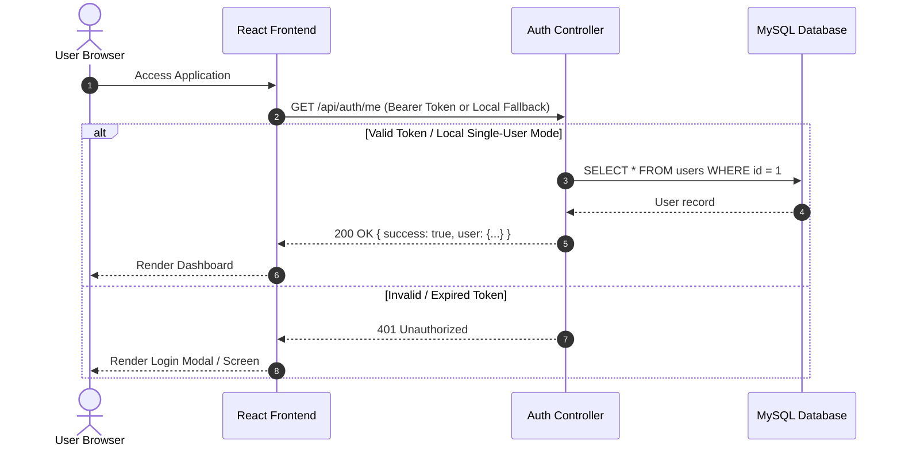

### 1.2 Diagram 2: AI Assistant Query with Local Tool Execution
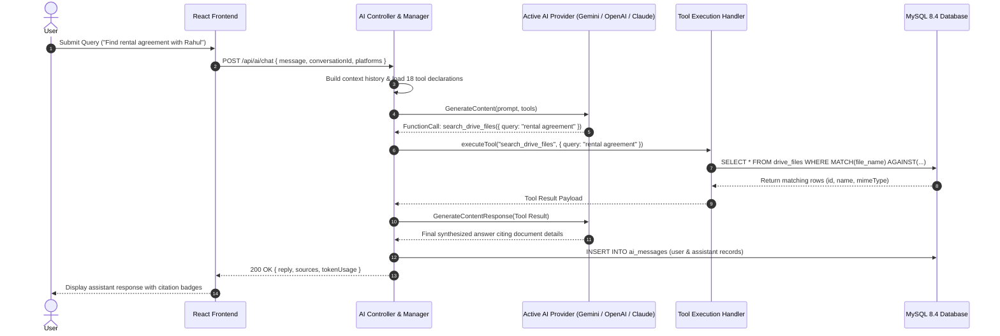

### 1.3 Diagram 3: Multi-Turn Conversation Context Retention
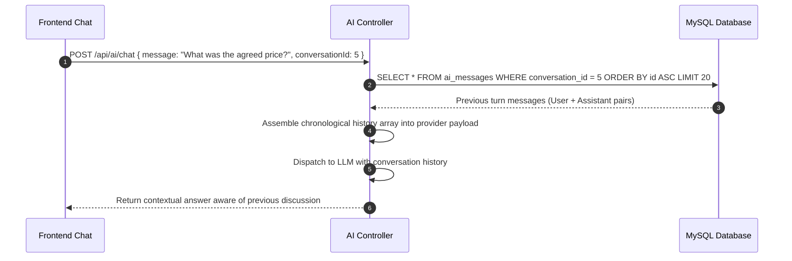

### 1.4 Diagram 4: Multi-Provider Query Routing & Key Resolution
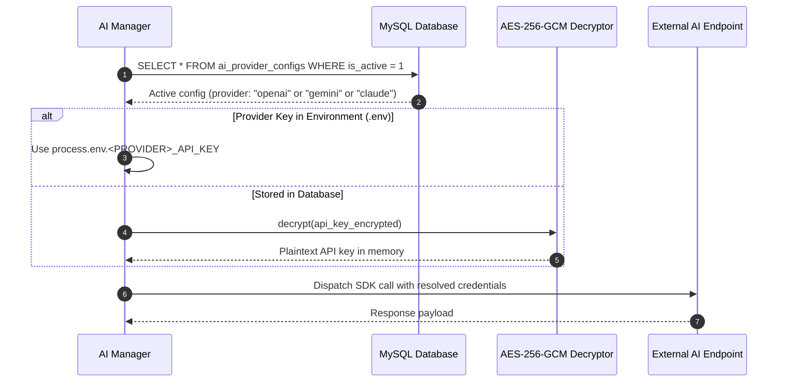

### 1.5 Diagram 5: Google OAuth 2.0 Connection & Token Refresh
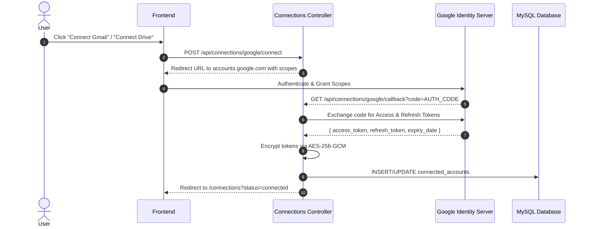

### 1.6 Diagram 6: Gmail Incremental Synchronization
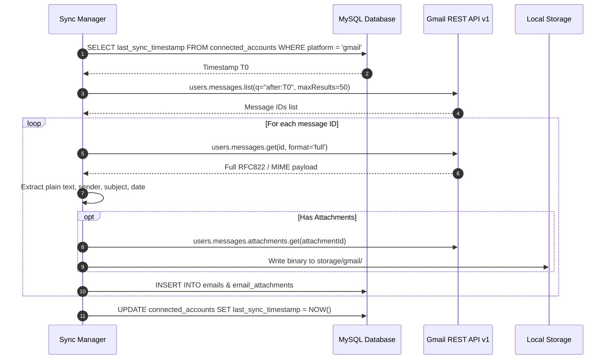

### 1.7 Diagram 7: Google Drive File Ingestion & Text Extraction
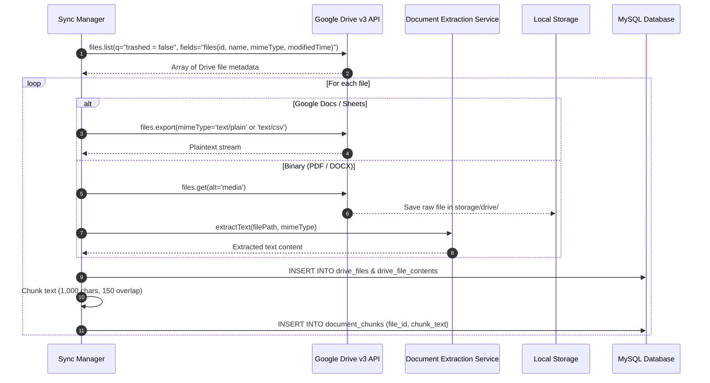

### 1.8 Diagram 8: WhatsApp QR Code Pairing via Baileys
```mermaid
sequenceDiagram
    autonumber
    actor User as User
    participant FE as Frontend
    participant WA as WhatsApp Connector Service
    participant Baileys as @whiskeysockets/baileys
    participant WA_Net as WhatsApp Multi-Device Gateway

    User->>FE: Click "Show QR Code"
    FE->>WA: GET /api/whatsapp/qr
    WA->>Baileys: makeWASocket({ auth: state })
    Baileys->>WA_Net: Initiate Noise Protocol Handshake
    WA_Net-->>Baileys: Connection.update { qr: "RAW_QR_STRING" }
    Baileys->>WA: Generate QR Data URL
    WA-->>FE: 200 OK { qr: "data:image/png;base64,..." }
    FE-->>User: Display QR on screen
    User->>WA_Net: Scan QR with WhatsApp mobile app
    WA_Net-->>Baileys: Handshake successful -> emit 'creds.update'
    Baileys->>WA: Session verified & keys saved
    WA->>FE: Emit Socket.IO 'connection:status' { platform: 'whatsapp', status: 'connected' }
    FE-->>User: Update badge to "Active"
```

### 1.9 Diagram 9: WhatsApp REST API Synchronization
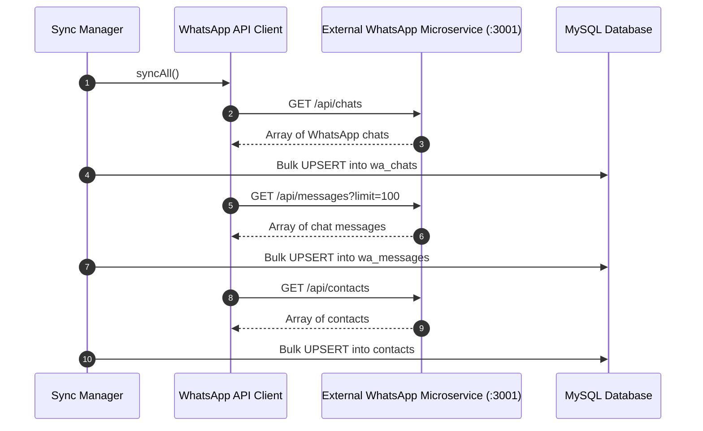

### 1.10 Diagram 10: Document Chunking & FULLTEXT Indexing
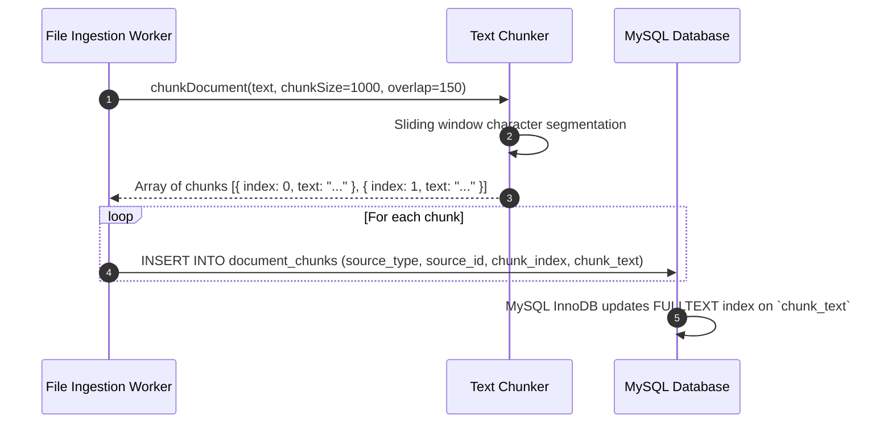

### 1.11 Diagram 11: Multi-Format Business Report Generation
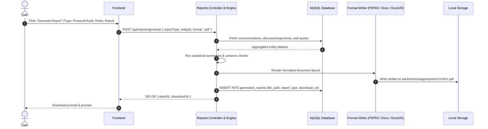

### 1.12 Diagram 12: Dynamic Dashboard Metrics Calculation
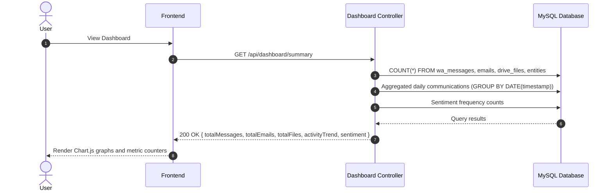

---

## 2. Technology Stack & Exact Versions

| Component | Package / Tool | Version | Responsibility |
|---|---|---|---|
| **Frontend Framework** | `react` | `^18.3.1` | User interface rendering |
| **Frontend DOM** | `react-dom` | `^18.3.1` | DOM manipulation |
| **Build Tool** | `vite` | `^5.2.0` | Development server and rollup bundler |
| **Styling** | `tailwindcss` | `^3.4.1` | Utility-first CSS styling |
| **Icons** | `lucide-react` | `^0.363.0` | SVG UI icons |
| **Charts** | `chart.js` / `react-chartjs-2` | `^4.4.2` / `^5.2.0` | Interactive data visualization |
| **WebSocket Client** | `socket.io-client` | `^4.7.5` | Real-time frontend events |
| **Backend Runtime** | `node.js` | `>=20.0.0` | ECMAScript Modules runtime |
| **Web Server** | `express` | `^4.19.2` | REST API routing and middleware |
| **WebSocket Server** | `socket.io` | `^4.7.5` | Real-time backend event dispatch |
| **Database Driver** | `mysql2` | `^3.9.7` | MySQL connection pool and prepared statements |
| **Database Engine** | `MySQL Community Server` | `8.0` / `8.4 LTS` | Relational and FULLTEXT data storage |
| **Google GenAI** | `@google/genai` | `^0.1.1` | Official Google Gemini API client |
| **OpenAI SDK** | `openai` | `^4.38.0` | OpenAI ChatGPT model invocation |
| **Anthropic SDK** | `@anthropic-ai/sdk` | `^0.20.0` | Anthropic Claude model invocation |
| **WhatsApp Socket** | `@whiskeysockets/baileys` | `^6.6.0` | WhatsApp Web multi-device socket connection |
| **Google APIs** | `googleapis` | `^137.0.0` | Gmail and Google Drive v3 OAuth clients |
| **PDF Parser** | `pdf-parse` | `^1.1.1` | Digital PDF plain-text extraction |
| **Word Parser** | `mammoth` | `^1.7.1` | Microsoft Word (`.docx`) extraction |
| **Excel Parser** | `xlsx` | `^0.18.5` | Spreadsheet data extraction |
| **PDF Generator** | `pdfkit` | `^0.15.0` | Vector PDF document creation |
| **Word Generator** | `docx` | `^8.5.0` | OpenXML Word document creation |
| **Excel Generator** | `exceljs` | `^4.4.0` | Multi-tab styled spreadsheet export |
| **JWT Library** | `jsonwebtoken` | `^9.0.2` | JSON Web Token session signing |

---

## 3. Database Architecture & Schema Reference

Unified AI Workspace utilizes **28 relational tables** designed in third normal form with InnoDB foreign key constraints, `ON DELETE CASCADE`, and utf8mb4 collation:

```
+-----------------------------------------------------------------------------------+
|                               DATABASE ENTITY MAP                                 |
+-----------------------------------------------------------------------------------+
| users --------------+--< connected_accounts                                       |
|                     +--< ai_conversations -----+--< ai_messages                   |
|                     |                          +--< ai_query_sources              |
|                     +--< ai_dashboards --------+--< ai_dashboard_widgets          |
|                                                                                   |
| entities -----------+--< entity_aliases                                           |
|                     +--< contacts                                                 |
|                     +--< wa_messages                                              |
|                     +--< emails                                                   |
|                                                                                   |
| wa_chats -----------+--< wa_messages                                              |
|                                                                                   |
| emails -------------+--< email_attachments                                        |
|                                                                                   |
| drive_folders ------+--< drive_files ----------+--< drive_file_contents           |
|                                                +--< document_chunks               |
|                                                                                   |
| generated_reports --+--< report_sections                                          |
|                                                                                   |
| system_logs | sync_jobs | sync_logs | app_settings | ai_provider_configs              |
+-----------------------------------------------------------------------------------+
```

### Table Summary:
1. `users`: Workspace administrator accounts and login hashes.
2. `connected_accounts`: Stores encrypted OAuth tokens, WhatsApp phone numbers, and sync timestamps.
3. `entities`: Resolved people and organizations with consolidated metadata.
4. `entity_aliases`: Alternative names, nicknames, and identifiers mapped to an entity.
5. `contacts`: Address book contacts pulled from WhatsApp, Gmail, or manual entry.
6. `wa_chats`: WhatsApp chat metadata (individual vs group, participant lists).
7. `wa_messages`: Ingested WhatsApp chat messages with FULLTEXT index on `message_text`.
8. `emails`: Gmail messages with subject, sender, recipients, timestamps, and thread IDs.
9. `email_attachments`: Records of attachments downloaded from Gmail.
10. `drive_folders`: Google Drive directory hierarchy.
11. `drive_files`: Ingested Google Drive files and download references.
12. `drive_file_contents`: Extracted plaintext representations of Drive documents.
13. `document_chunks`: 1,000-character segments of documents with FULLTEXT index for AI search.
14. `ai_conversations`: Chat sessions in the AI Assistant.
15. `ai_messages`: User prompts and assistant responses.
16. `ai_query_sources`: Records cited by the AI Assistant during answers.
17. `ai_provider_configs`: Encrypted API keys and active models for Gemini, OpenAI, and Claude.
18. `generated_reports`: Metadata and download paths for generated business reports.
19. `report_sections`: Structured content blocks within generated reports.
20. `ai_dashboards`: User-configured custom dashboards.
21. `ai_dashboard_widgets`: Individual widgets and chart configs inside dashboards.
22. `sync_jobs`: State machine tracking background sync tasks.
23. `sync_logs`: Historical log of all synchronization runs.
24. `system_logs`: Application-wide diagnostic log entries.
25. `app_settings`: Key-value system configuration store.
26. `schema_migrations`: Version tracking table for applied database migrations.

---

## 4. Multi-Provider AI Architecture & Tool Calling

### 4.1 Architecture
The AI layer is abstracted behind `AIManager.js`. It routes incoming chat requests to the configured provider:
- **Google Gemini Provider:** Interacts via `@google/genai` using native function calling declarations.
- **OpenAI Provider:** Interacts via `openai` using JSON Schema tool definitions.
- **Anthropic Claude Provider:** Interacts via `@anthropic-ai/sdk` using tool use definitions.

### 4.2 Available AI Tools
The engine exposes **18 specialized backend tools** to the LLM:
1. `search_whatsapp_messages(query, limit)`
2. `get_whatsapp_chat_history(chatJid, limit)`
3. `search_gmail_emails(query, limit)`
4. `get_email_thread(threadId)`
5. `search_drive_files(query, limit)`
6. `get_document_text(fileId)`
7. `search_document_chunks(query, limit)`
8. `get_client_dossier(entityNameOrId)`
9. `get_client_timeline(entityId)`
10. `find_invoices_and_payments(query, entityId)`
11. `find_commitments_and_agreements(entityId)`
12. `compare_documents(docIdA, docIdB)`
13. `get_connection_status()`
14. `get_system_statistics()`
15. `search_entities(query)`
16. `get_recent_communications(limit)`
17. `summarize_client_interactions(entityId)`
18. `query_financial_highlights(entityId)`

---

## 5. Google OAuth 2.0 Integration & Token Lifecycle

- **Redirect URI:** `http://localhost:5000/api/connections/google/callback`
- **Scopes Requested:**
  - `https://www.googleapis.com/auth/userinfo.email`
  - `https://www.googleapis.com/auth/userinfo.profile`
  - `https://www.googleapis.com/auth/gmail.readonly`
  - `https://www.googleapis.com/auth/drive.readonly`
- **Token Security:** When tokens are returned by Google, `access_token` and `refresh_token` are encrypted with AES-256-GCM using `CREDENTIAL_ENCRYPTION_KEY` before insertion into `connected_accounts`.
- **Automatic Refresh:** `google.js` inspects token expiration before every API call; if expired, it uses the decrypted refresh token to acquire a new access token without user intervention.

---

## 6. WhatsApp Integration: Baileys Socket vs. Archive API

| Characteristic | Direct Baileys Mode | External Archive REST API Mode |
|---|---|---|
| **Protocol** | WebSockets (Noise Protocol) | HTTP / REST JSON |
| **Pairing** | Mobile QR Code Scan | Pre-authenticated Microservice |
| **Network Location** | Embedded in Node.js process | Independent service (default: `:3001`) |
| **Media Handling** | Decrypted on-the-fly via Baileys | Proxied via REST endpoints |
| **Configuration** | Default mode (no extra configuration) | Set `WHATSAPP_API_BASE_URL` in `.env` |

---

## 7. Complete REST API Reference

| Method | Endpoint | Description | Auth Required |
|---|---|---|---|
| `POST` | `/api/auth/login` | Authenticate user and receive JWT token | No |
| `POST` | `/api/auth/logout` | Terminate active user session | Yes |
| `GET` | `/api/auth/me` | Fetch active user profile | Yes |
| `GET` | `/api/connections` | Retrieve status of WhatsApp, Gmail, and Drive | Yes |
| `POST` | `/api/connections/:platform/connect` | Initiate connection or get OAuth redirect URL | Yes |
| `DELETE` | `/api/connections/:platform` | Disconnect platform and purge session | Yes |
| `GET` | `/api/whatsapp/qr` | Get current WhatsApp Web pairing QR code | Yes |
| `GET` | `/api/whatsapp/chats` | List synchronized WhatsApp conversations | Yes |
| `GET` | `/api/whatsapp/messages` | Fetch messages for a specific conversation | Yes |
| `GET` | `/api/gmail/messages` | List synchronized Gmail emails | Yes |
| `GET` | `/api/gmail/threads/:id` | Fetch complete Gmail email thread | Yes |
| `GET` | `/api/drive/files` | List synchronized Google Drive files | Yes |
| `GET` | `/api/documents` | Browse indexed documents with chunk counts | Yes |
| `GET` | `/api/documents/:id/preview` | Preview extracted plaintext of a document | Yes |
| `POST` | `/api/ai/chat` | Submit a prompt to the AI Assistant | Yes |
| `GET` | `/api/ai/conversations` | List user conversation history | Yes |
| `POST` | `/api/ai/test-connection` | Test connection to the active AI model | Yes |
| `GET` | `/api/entities` | List resolved clients and entities | Yes |
| `GET` | `/api/entities/:id` | Retrieve comprehensive client dossier | Yes |
| `GET` | `/api/entities/:id/timeline` | Retrieve chronological client interaction timeline | Yes |
| `POST` | `/api/reports/generate` | Generate business report (PDF/DOCX/XLSX/CSV) | Yes |
| `GET` | `/api/reports` | List generated report history | Yes |
| `GET` | `/api/reports/:id/download` | Download generated report artifact | Yes |
| `GET` | `/api/dashboard/summary` | Fetch dashboard analytics and metrics | Yes |
| `GET` | `/api/sync/status` | Get status of background sync workers | Yes |
| `POST` | `/api/sync/start` | Manually trigger synchronization job | Yes |
| `GET` | `/api/settings` | Get current system settings | Yes |
| `POST` | `/api/settings` | Update system settings | Yes |
| `GET` | `/api/settings/ai-providers` | List configured AI providers and models | Yes |
| `POST` | `/api/settings/ai-providers` | Save API key and model for AI provider | Yes |
| `GET` | `/api/logs` | Query system diagnostic logs | Yes |

---

## 8. Security & Privacy Architecture

- **Threat Model:** The application is designed to operate locally on the user's workstation or private network. It assumes physical or operating-system-level isolation from untrusted parties.
- **Cryptographic Algorithms:**
  - **At Rest:** AES-256-GCM authenticated encryption for all stored API keys, OAuth access tokens, and refresh tokens.
  - **In Transit:** HTTPS/TLS for Google and AI APIs; WSS for WhatsApp Baileys.
  - **Sessions:** HMAC-SHA256 signed JSON Web Tokens (JWT).
- **Network Boundaries:** Only outgoing requests to configured APIs (Google, WhatsApp, AI provider) are performed. The backend does not phone home, report telemetry, or transmit database contents to any central server.
