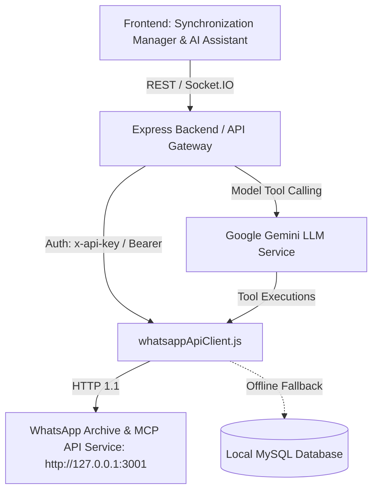

# WhatsApp API Integration Guide

**Application:** Unified AI Workspace  
**Module:** WhatsApp Connector & Synchronization Manager  
**Status:** Integrated, Production Verified  

---

## 1. Architectural Overview

Unified AI Workspace connects to an external WhatsApp API service that serves as the primary data source for the user's WhatsApp archive, live status, chat history, contacts, groups, analytics, search, and MCP operations.



### Key Principles
1. **Security & Privacy:** API keys (`x-api-key`, `Authorization: Bearer <key>`) are held securely on the backend in environment variables. They are never transmitted or exposed to frontend code. Sensitive message contents are redacted in logs.
2. **Offline Resilience:** If the external WhatsApp API service is offline, down, or experiencing network latency, the integration client automatically transitions service health to `unreachable`, surfaces an alert banner with a `Retry Connection` action in the UI, and falls back to cached local MySQL records (`wa_chats`, `wa_messages`, `wa_contacts`, `wa_groups`).
3. **AI First-Class Knowledge Source:** The AI assistant uses the WhatsApp API connector endpoints (`/api/connector/search`, `/api/messages/:id/context`, `/api/chats/:chatId/transcript`, `/api/contacts`, `/mcp`) to retrieve live context for questions about client communications, rental agreements, quotes, and payment commitments.

---

## 2. Configuration Settings

The following configuration options are exposed in `backend/.env` and `backend/src/config/env.js`:

| Environment Variable | Default Value | Description |
|---|---|---|
| `WHATSAPP_API_BASE_URL` | `http://localhost:3001` | Base URL of the external WhatsApp API service |
| `WHATSAPP_API_KEY` | *(optional)* | Secret API key sent via `x-api-key` and `Authorization: Bearer <key>` |
| `WHATSAPP_API_TIMEOUT_MS` | `8000` | Request timeout in milliseconds (aborts hangs) |
| `WHATSAPP_POLL_INTERVAL_MS` | `5000` | Live status polling interval in milliseconds |

---

## 3. Supported Endpoints

### A. System & Status
* `GET /`: Lists all available service endpoints and API metadata.
* `GET /api/health`: Server uptime, system health, and service availability.
* `GET /api/status`: Active WhatsApp connection state, account phone, and sync status.
* `GET /api/stats`: Total archive counts (chats, messages, groups, media, links, participants).
* `POST /api/sync/groups`: Triggers synchronization of WhatsApp group metadata and participants.

### B. Chats & Messages
* `GET /api/chats`: List chats (supports `type`, `q`, `limit`, `offset`).
* `GET /api/chats/:chatId`: Detailed metadata for a specific chat.
* `GET /api/chats/:chatId/messages`: Retrieve chronological messages for a conversation.
* `GET /api/chats/:chatId/stats`: Chat-specific message and media analytics.
* `GET /api/chats/:chatId/media`: Media attachments in a chat.
* `GET /api/chats/:chatId/links`: Shared links in a chat.
* `GET /api/chats/:chatId/participants`: Group participant listing.
* `GET /api/chats/:chatId/timeline`: Interaction timeline.
* `GET /api/chats/:chatId/transcript`: Formatted plain-text conversation transcript.
* `GET /api/messages`: Filter messages (`chatId`, `sender`, `fromMe`, `isGroup`, `type`, `kind`, `hasText`, `from`, `to`, `q`, `order`, `limit`, `offset`). Maximum limit: 500.
* `GET /api/messages/:id`: Message by ID.
* `GET /api/messages/:id/context`: Messages immediately preceding and following the target message.
* `GET /api/messages/:id/replies`: Message replies thread.

### C. Search, Contacts & Groups
* `GET /api/search?q=`: Keyword message search.
* `GET /api/search/all?q=&scope=`: Multi-entity search across messages, contacts, and groups.
* `GET /api/contacts`: Contact directory lookup.
* `GET /api/contacts/:id`: Specific contact profile.
* `GET /api/contacts/:id/messages`: Messages exchanged with contact.
* `GET /api/contacts/:id/stats`: Interaction frequency and stats with contact.
* `GET /api/groups`: Group directory listing.
* `GET /api/groups/:id`: Group details.
* `GET /api/groups/:id/messages`: Group conversation history.
* `GET /api/groups/:id/participants`: Participant members and role.

### D. Analytics & Export
* `GET /api/analytics/:type?tzOffset=330`: Analytics metrics (`daily`, `weekly`, `monthly`, `hours`, `top-senders`, `summary`) adjusted for local timezone offset.
* `GET /api/export/messages?format=json|csv`: Export archive data as JSON or CSV.

### E. Connector & MCP Support
* `GET /api/connector/search?query=...&scope=...&limit=...`: AI semantic search retrieval.
* `GET /api/connector/fetch/:id`: Fetch record by connector ID.
* `POST /mcp`: Model Context Protocol execution for deep reasoning and action fulfillment.

---

## 4. Synchronization Manager User Interface

The Synchronization Manager (`/sync`) has been upgraded from the placeholder state to a live management dashboard:
1. **Live Status Cards:**
   - **Connection State:** Real-time state (`Connected`, `Connecting`, `Disconnected`) with active indicator.
   - **Service Health:** Real-time health (`Reachable`, `Unreachable`, `Degraded`).
   - **Last Sync Time:** Formatted timestamp of the most recent sync run.
   - **Sync Mode:** Shows `API + Storage` when live, or `Local Database Cache` when offline.
2. **Archive Totals Grid:**
   - Total Chats
   - Total Messages
   - Total Groups
   - Media Files
   - Total Links
   - Participants
3. **Manual Actions:**
   - **Sync Groups:** Visible button triggering `POST /api/sync/groups`. Displays an animated spinner and a feedback toast upon completion.
   - **Retry Connection:** Displayed when the external service is offline, enabling one-click re-evaluation.
4. **Live Polling:**
   - Background polling every 6 seconds ensures metrics are updated without refreshing the page.
5. **Synchronization History:**
   - Interactive table logging each synchronization run with timestamp, status, duration, and processed counts.

---

## 5. Verification & Testing Instructions

To verify all 12 endpoints:

1. **Start the Mock WhatsApp Service (if running locally):**
   ```powershell
   npm --prefix unified-ai-workspace/backend run mock:whatsapp
   ```
2. **Execute the Verification Runner:**
   ```powershell
   npm --prefix unified-ai-workspace/backend run test:whatsapp
   ```
   All 12 endpoints will execute and report status codes, latency, and sample response previews.
